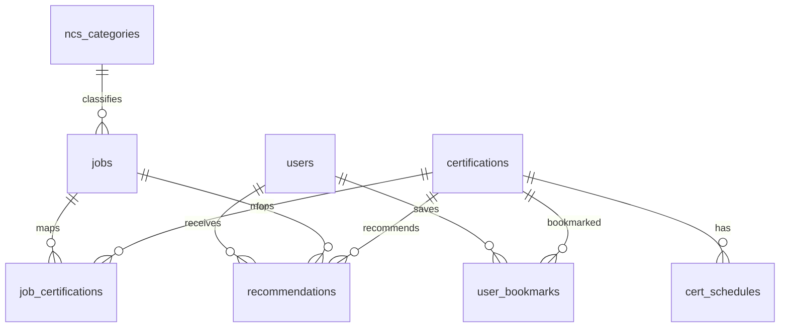
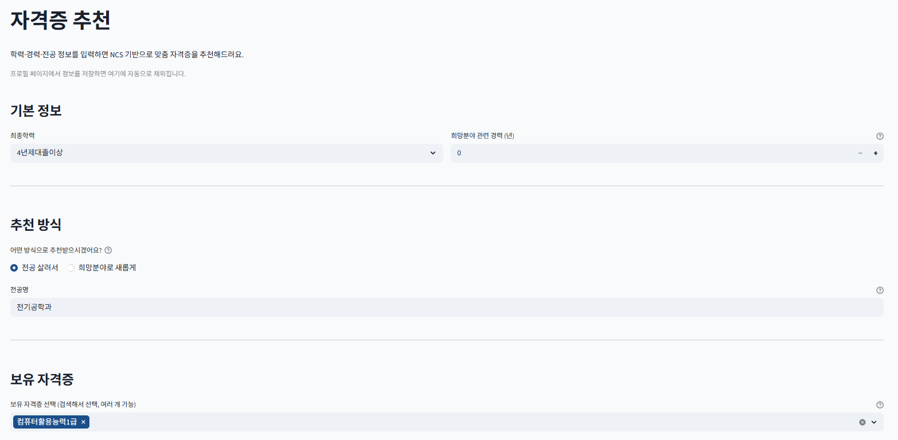
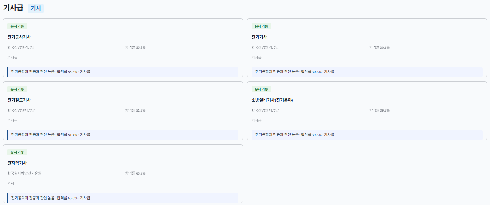
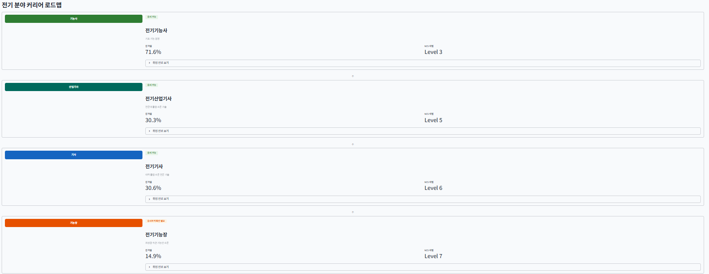
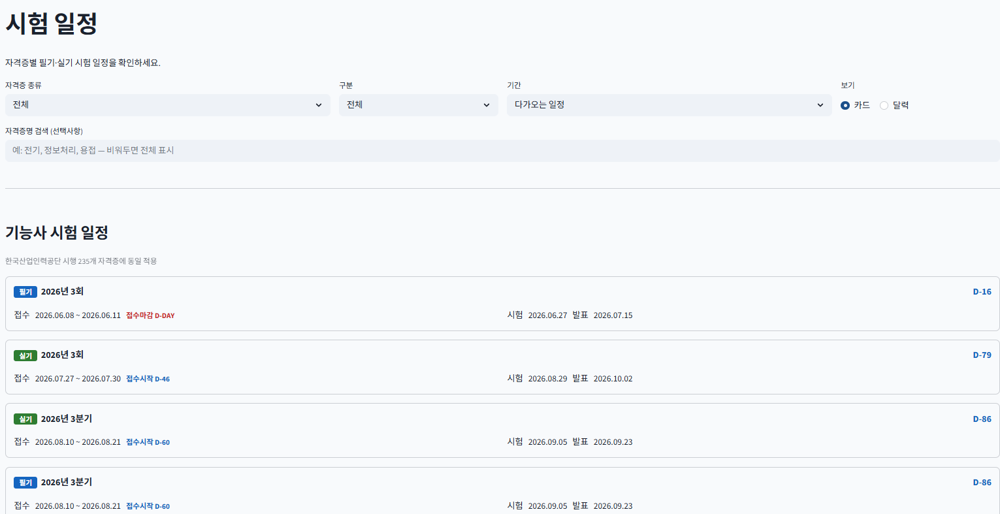

# NCS 기반 지능형 커리어 네비게이터

내 학력·경력·전공·희망 분야를 입력하면 **응시 가능한 국가자격증을 걸러내고**, 희망 직무와의 **의미 유사도**로 어울리는 자격증을 추천해 주는 웹 서비스입니다. (1학기 캡스톤 프로젝트, 2026.03 ~ 06)

## 주요 기능

- 회원가입 / 로그인, 프로필 입력 (학력, 실무경력, 보유 자격증, 희망 분야·지역)
- 자격증 추천: 응시자격 필터링 → SBERT 유사도 계산 → 점수 합산 → 추천 이유 제공
- 시험 일정 조회와 즐겨찾기 D-Day 표시
- 커리어 로드맵: 같은 분야의 자격 등급(기능사 → 산업기사 → 기사 → 기능장 → 기술사) 순서로 취득 경로 안내

## 추천 방식

| 단계 | 내용 |
|---|---|
| STEP 1 | 학력·경력·보유 자격증 기준으로 응시 가능한 자격증만 필터링 (산업기사/기사/기능장/기술사 응시자격 반영) |
| STEP 2 | 한국어 SBERT(`jhgan/ko-sroberta-multitask`)로 희망 분야·전공과 자격증 정보의 코사인 유사도 계산. 전공 기반 추천은 온톨로지(관련 전공) 유사도 0.6 + 자격증 도메인명 유사도 0.4를 합산한 하이브리드 방식 사용 |
| STEP 3 | 유사도, 합격률, NCS 수준(자격 등급)을 가중치로 합산해 최종 점수 계산 (입문용 = 합격률 우선 / 실용형 = 등급 우선 두 가지 모드) |
| STEP 4 | 점수순 추천 결과와 추천 이유 반환 |

## 기술 스택

- Python, Streamlit
- MySQL (8개 테이블: 회원, NCS 분류, 직무, 자격증, 직무-자격 매핑, 시험일정, 즐겨찾기, 추천 기록)
- sentence-transformers (SBERT), pandas

## 데이터

공공데이터와 공개 통계를 정제해 MySQL에 적재했습니다.

- 한국산업인력공단 NCS 능력단위별 자격종목 / 국가기술자격 종목별 시험정보 (공공데이터포털)
- 한국산업인력공단 통계연보(합격률 5개년 평균 산출)
- 국가기술자격 637개 + 국가전문자격 37개 (총 674개)

`data/` 폴더에 원본 파일과 DB 적재·갱신 스크립트가 있습니다.

## 데이터 모델



- 주요 테이블: `certifications`(자격증, 합격률·NCS 레벨·진로 정보), `ncs_categories`(NCS 4단계 분류), `cert_schedules`(시험 일정), `users`, `user_bookmarks`
- 즐겨찾기는 `(user_id, cert_id)` 복합 UNIQUE 제약으로 중복 저장을 막습니다.
- `jobs`, `job_certifications`, `recommendations` 테이블은 직무 기반 추천 확장을 위해 설계해 두었으나, **현재 앱에서는 사용하지 않습니다.**

## 데이터 구축과 정제

- **온톨로지 직접 구축:** 공식 데이터에 "전공 ↔ 자격증" 연결 정보가 없어, 자격증별 관련 전공·키워드·NCS 세분류를 직접 조사해 `models/ontology.py`(약 3,400줄)로 구축했습니다.
- **수치 정규화:** NCS 레벨(3/5/6/7/8)을 0.3~0.8로, 합격률을 0~1로 변환해 점수 계산의 스케일을 맞췄습니다. 합격률이 없는 국가전문자격은 해당 항목을 제외하고 계산합니다.
- **응시자격 특수 처리:** 전제 자격, 경력, 어학성적 조건이 별도로 있는 일부 자격증(사회조사분석사, 직업상담사 등)은 따로 구현했습니다.

## 폴더 구조

```
app.py            # 페이지 구성 (st.navigation)
home.py           # 홈 화면
pages/            # 로그인, 프로필, 자격증추천, 시험일정, 커리어로드맵, 즐겨찾기
models/           # 추천 로직(recommender.py), 동의어 사전, 온톨로지
utils/            # DB 연결, SBERT 모델 캐시, 스타일
db/init_database.sql   # DB 스키마
data/             # 원본 데이터와 적재 스크립트
```

## 실행 방법

1. 의존성을 설치합니다.
   ```bash
   pip install -r requirements.txt
   ```
2. MySQL에서 스키마를 만듭니다.
   ```bash
   mysql -u root -p < db/init_database.sql
   ```
   > 각 테이블을 `DROP TABLE IF EXISTS` 후 다시 만들므로, 이미 데이터가 있는 DB에서는 실행하지 마세요.
3. `.env.example`을 `.env`로 복사하고 DB 정보를 입력합니다.
4. `data/` 폴더의 스크립트로 자격증 데이터를 적재합니다. (`import_csv.py` 등)
5. 실행합니다.
   ```bash
   streamlit run app.py
   ```

처음 실행하면 SBERT 모델을 내려받느라 시간이 걸릴 수 있습니다.

## 현재 상태 / 한계

- 구인공고 API(WorkNet/Saramin) 승인이 나지 않아 **채용 공고 수 기반 추천은 연동하지 못했습니다.**
- 자격증 데이터가 한정적이어서 추천 다양성에 한계가 있습니다.
- 비밀번호는 SHA-256으로 저장하고 있어, 실서비스라면 솔트가 있는 bcrypt 등으로 바꿔야 합니다.
- 온톨로지(관련 전공·직무 매핑)가 조선·농림 등 일부 기능장급 분야에서는 부족합니다.
- 추천 만족도 같은 정량 평가는 진행하지 못했습니다.

## 스크린샷

| 자격증 추천 입력 | 추천 결과 (기사급) |
|---|---|
|  |  |

| 커리어 로드맵 | 시험 일정 |
|---|---|
|  |  |
